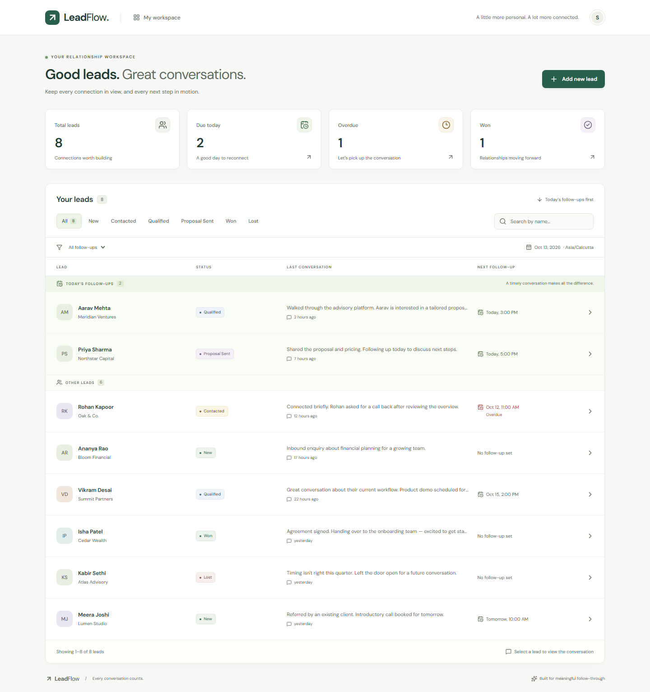
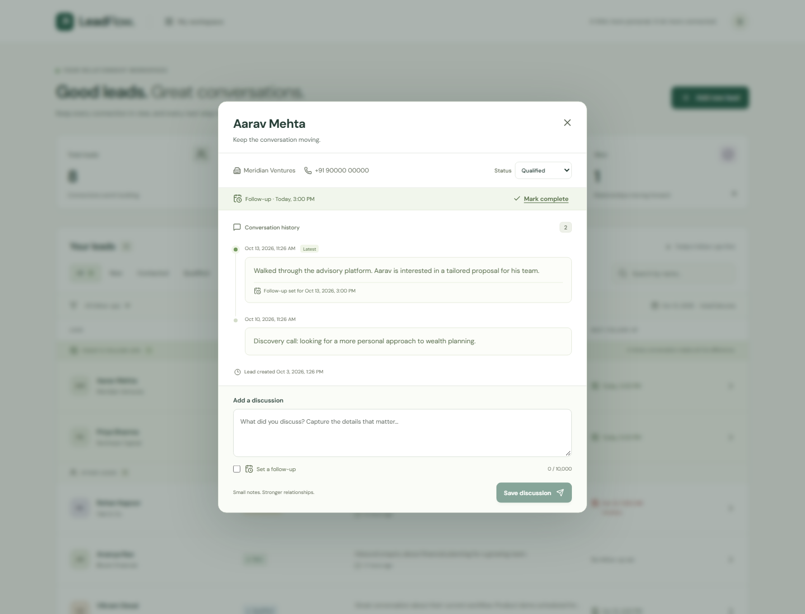
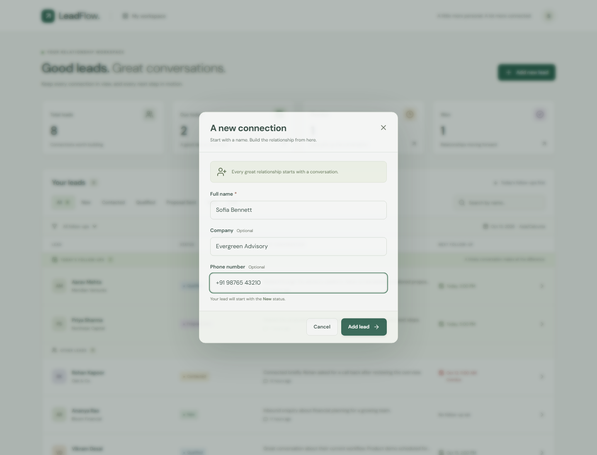
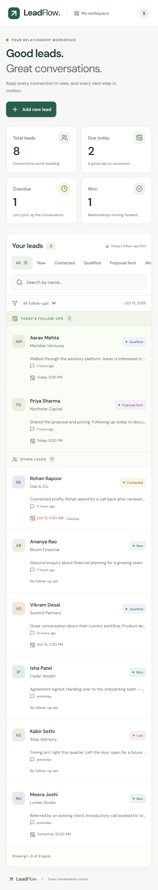

# LeadFlow

A single-screen lead management workspace for tracking conversations and following through. Built with Next.js, React, FastAPI, SQLAlchemy, and PostgreSQL. SQLite provides a zero-service local setup.



## Run with Docker

Requires Docker Engine with Compose v2. Start Docker Desktop first on Windows/macOS.

```sh
cp .env.example .env
docker compose up --build -d --wait
docker compose exec api python -m app.seed --timezone Asia/Kolkata
```

On PowerShell, use `Copy-Item .env.example .env` instead of `cp` if preferred. Open **http://localhost:3000**. The API and database are private to the Compose network. Only the web port is published, on loopback. The first build downloads dependencies and can take several minutes.

```sh
docker compose logs -f api web
docker compose down
```

`down` preserves the PostgreSQL volume. Demo data is never inserted automatically; the explicit seed command creates eight fictional leads and fourteen discussions covering every status. It is idempotent and preserves subsequent edits. Reminders are relative to the seed date in the requested IANA timezone.

## Run locally

Requires **Python 3.13** and **Node.js 24 LTS**. Run all initial commands from the repository root. Do not run the local servers and Compose on port 3000 simultaneously.

### Windows / PowerShell

```powershell
Copy-Item .env.example .env
python -m venv .venv
.\.venv\Scripts\python.exe -m pip install -r backend/requirements-dev.txt
Set-Location backend
..\.venv\Scripts\python.exe -m alembic upgrade head
..\.venv\Scripts\python.exe -m app.seed --timezone Asia/Kolkata
..\.venv\Scripts\python.exe -m uvicorn app.main:app --host 127.0.0.1 --port 8000
```

In a second terminal, from the repository root:

```powershell
Set-Location frontend
npm.cmd ci
npm.cmd run dev
```

### macOS / Linux

```sh
cp .env.example .env
python3.13 -m venv .venv
.venv/bin/python -m pip install -r backend/requirements-dev.txt
cd backend
../.venv/bin/python -m alembic upgrade head
../.venv/bin/python -m app.seed --timezone Asia/Kolkata
../.venv/bin/python -m uvicorn app.main:app --host 127.0.0.1 --port 8000
```

In a second terminal:

```sh
cd frontend
npm ci
npm run dev
```

Open **http://localhost:3000**. Local data persists in `backend/leadflow.db`. The development API documentation is at http://127.0.0.1:8000/api/docs. Use the browser through port 3000 so API requests and session cookies remain same-origin.

To verify/run an optimized frontend, stop the frontend development server, then run `npm run build` followed by `npm run start` from `frontend`. The start script serves the standalone build with its bundled static assets. The API remains a separate process.

## Working flow

1. **Add new lead**: name is required; company and phone are optional. A lead starts as **New**.
2. **Open a lead**: the dialog shows the most recent discussion first. Older history can be loaded without leaving the screen.
3. **Save a discussion**: enter a note and optionally set a follow-up date/time. The list and workspace totals refresh immediately after the server confirms the transaction.
4. **Update status**: choose New, Contacted, Qualified, Proposal Sent, Won, or Lost in the dialog. Changes persist immediately.
5. **Follow through**: today's reminders stay at the top, overdue reminders are red and explicitly labelled, and **Mark complete** clears the current reminder without deleting historical notes.
6. Search by name, filter by status, and filter by due/overdue reminders. Filters combine. List pages contain at most 25 leads.







## Defined behavior

- Timestamps are stored in UTC and displayed in the browser's timezone. The API uses the browser's IANA timezone to compute calendar-day boundaries, including 23- and 25-hour daylight-saving days. The workspace displays its timezone and refreshes periodically and on focus.
- Today's reminders are ordered by time **before pagination**, followed by overdue reminders from earlier days, then other leads ordered by most recently updated. A reminder earlier today is both pinned and overdue.
- Saving without a follow-up preserves an existing reminder. Completing one is explicit. Status changes do not silently erase reminders, including on Won/Lost leads.
- Past follow-up dates are allowed for recording existing commitments and are marked overdue. Nonexistent local times during a spring daylight-saving transition are rejected. For a repeated local time in autumn, the browser Date conversion selects the earlier occurrence.
- A discussion and its lead/reminder/version update commit in one database transaction. Stale versions receive `409 Conflict`; the UI refreshes details and preserves the draft for review and retry.
- Lead and discussion creation use client-generated UUID request IDs. An unchanged retry does not create a duplicate, even if the initial response was lost. Reusing an ID with different content returns `409`.
- Search is a case-insensitive literal name substring match; SQL wildcard characters are escaped. ASCII case folding is portable across SQLite/PostgreSQL; linguistic Unicode folding follows the database collation.
- Input is length-bounded and validated on the server. Discussion text is rendered as plain text. Drafts are held in browser memory and a close confirmation protects unsaved discussions; a page reload or expired session discards unsaved input.
- Follow-ups are in-app reminders. The assignment does not request email, push notifications, or background delivery, so none are sent.

## Configuration

Both the local API and frontend build load the root `.env`; process environment variables take precedence. No secrets are exposed through `NEXT_PUBLIC_*` variables. Compose supplies its internal API/database URLs itself.

| Variable | Purpose / default |
| --- | --- |
| `APP_ENV` | `development`, `test`, or `production`; default `development` |
| `DATABASE_URL` | Local default `sqlite:///./leadflow.db`; use `postgresql+psycopg://...` for PostgreSQL |
| `PUBLIC_ORIGIN` | Exact browser origin, default `http://localhost:3000`; checked on mutations |
| `APP_PASSWORD` | Optional shared workspace password locally; production requires at least 16 characters |
| `SESSION_SECRET` | Random signing secret of at least 32 characters; required when authentication is enabled |
| `COOKIE_SECURE` | `true` for HTTPS; production requires `true` |
| `API_INTERNAL_URL` | Next.js server-side upstream, default `http://127.0.0.1:8000`; baked into the frontend build |
| `POSTGRES_USER`, `POSTGRES_PASSWORD`, `POSTGRES_DB` | Compose database credentials; replace development defaults before deployment |
| `LEADFLOW_HOST` | Local standalone web bind address; default `127.0.0.1` |

Change `API_INTERNAL_URL` **before building** and rebuild if it changes. It is not a browser-facing URL. Use a URL-safe random hexadecimal PostgreSQL password with the supplied Compose connection-string template; reserved URI characters require percent-encoding the connection URL separately.

## Production deployment

The application is a **single shared sales workspace**, with an optional local login and an enforced production password gate. It does not implement separate users, tenants, roles, or per-representative ownership.

1. Provision a domain, an HTTPS reverse proxy, durable PostgreSQL storage, and backups. Route the proxy to the loopback web port. Set an appropriate request-size and request-rate limit at the edge.
2. Set `APP_ENV=production`, `PUBLIC_ORIGIN=https://your-domain`, `COOKIE_SECURE=true`, a strong `APP_PASSWORD`, a random `SESSION_SECRET`, and non-default database credentials. Generate each secret with `python -c "import secrets; print(secrets.token_hex(32))"`. Store them in your deployment secret manager or an untracked `.env`.
3. Run `docker compose up --build -d --wait`. Production startup rejects missing credentials or insecure cookie/origin settings. Seed only when deliberately preparing a demonstration workspace.
4. Confirm `/api/health/ready`, a successful login, a saved discussion, and persistence after restarting the API. Monitor service health and application logs. No automatic public deployment is configured.

Sessions are signed, HttpOnly, SameSite=Strict cookies with a 12-hour lifetime. Password/secret rotation invalidates outstanding sessions. Logout removes the current browser cookie. Unsafe requests require a non-simple client header; cross-origin browser requests are rejected. The API emits non-cached responses, request IDs, safe validation errors, and generic unexpected-error responses. The web service sets framing, MIME, referrer, permission, and content-security headers. The CSP permits Next.js inline bootstrapping; a strict nonce CSP is a separate hardening option.

The Compose app containers run as non-root users with read-only filesystems, reduced capabilities, health checks, and resource limits. A single API worker is intentional: login throttling is in-process. Before scaling to multiple workers/replicas, move throttling to a shared store or enforce it at the trusted edge, run migrations as a separate release job, and use PostgreSQL. The API does not trust forwarded client-IP headers. Login attempts behind the proxy share its rate bucket.

For database backups, use PostgreSQL's native tools or managed backups. For example, capture a dump inside the database container, then copy it out (avoids binary-redirection issues in older PowerShell):

```sh
docker compose exec db pg_dump -U leadflow -d leadflow -Fc -f /tmp/leadflow.dump
docker compose cp db:/tmp/leadflow.dump ./leadflow.dump
```

Substitute your configured database/user. Keep backup files outside the public repository, encrypt them, and regularly test restores into a separate database. SQLite is intended for local use or small single-instance installations; use its online backup API rather than copying a live database file.

## Verification

Backend tests, from `backend`:

```sh
../.venv/bin/python -m pytest -q
../.venv/bin/python -m ruff check .
../.venv/bin/python -m ruff format --check .
```

On Windows replace `../.venv/bin/python` with `..\.venv\Scripts\python.exe`.

Frontend checks, from `frontend`:

```sh
npm ci
npm run lint
npm run typecheck
npm run format:check
npm run build
npx playwright install chromium
npm test
```

Stop local/Compose servers on ports **3000 and 8000** before `npm test`. The suite starts the production frontend and a separate API with a freshly migrated test SQLite database under ignored `.tools/`. It never uses your development database. Linux CI installs Chromium OS dependencies with `npx playwright install --with-deps chromium`. The optional `PYTHON` process environment variable overrides the test harness's virtualenv interpreter path.

Tests cover API validation, persistence, status changes, transactional conflicts, retry safety, timezone and DST boundaries, pagination, authentication, migration round trips, repeatable seeds, and the complete browser flow at desktop and mobile sizes. Browser checks also cover failed-save recovery, conflict recovery, focus restoration, horizontal overflow, and axe WCAG A/AA accessibility scans. GitHub Actions runs the API suite with SQLite and PostgreSQL, the frontend/browser checks, dependency audits, and a full Compose build/start/seed smoke test. `TEST_DATABASE_URL`, if set for backend tests, must identify a **disposable test database**: test tables are dropped.

Dependency audits:

```sh
# From the root, using the project's virtualenv Python
python -m pip_audit -r backend/requirements.txt
# From frontend
npm audit --audit-level=high
```

`requirements.txt`, `requirements-dev.txt`, and `package-lock.json` lock resolved dependencies. Update the `.in` files and installed backend environment, then regenerate Python locks with `python scripts/lock-python.py` and rerun tests/audits. Review dependency and base-image security updates regularly.

## API and structure

| Endpoint | Behavior |
| --- | --- |
| `GET /api/leads` | Paginated leads, search/status/reminder filters, counts, timezone-aware ordering |
| `POST /api/leads` | Create lead (`201`); identical retried request (`200`) |
| `GET /api/leads/{id}` | Lead detail and latest discussion |
| `PATCH /api/leads/{id}` | Change status or reminder with `expected_version` |
| `GET /api/leads/{id}/discussions` | Reverse-chronological, paginated discussion history |
| `POST /api/leads/{id}/discussions` | Atomically save note and optional reminder (`201`) |
| `GET /api/auth/session` | Session and authentication-mode state |
| `POST /api/auth/login`, `POST /api/auth/logout` | Shared workspace session |
| `GET /api/health/live`, `GET /api/health/ready` | Process/database readiness |

Mutation requests require `X-Leadflow-Client: web` or `cli`. JSON schemas are available at `/api/docs` in development. Errors use `401` for missing sessions, `403` for rejected origins/client headers, `404` for missing leads, `409` for stale/conflicting requests, `413` for oversized bodies, `422` for invalid input, and `429` for login throttling.

```text
backend/app/          API, validation, persistence, authentication, seed data
backend/migrations/   Versioned Alembic schema migrations
backend/tests/        API and database regression tests
frontend/src/         Single-screen UI, dialogs, query state, date handling
frontend/tests/       Desktop/mobile browser and accessibility tests
scripts/              Dependency locking and isolated test API startup
docs/screenshots/     Screenshots of the working application
.github/workflows/    Automated verification
```

The brief's stack preference is written as “NextJs + FastAI” but permits any stack. This implementation explicitly chooses **Next.js + FastAPI** for the web UI and REST API. There is no machine-learning requirement or artificial prediction feature.

## Submission

Public repository: **https://github.com/vatsal2025/leadflow**. The setup instructions, `.env.example`, meaningful commit history, and screenshots are included in this repository. See [the verification record](docs/VERIFICATION.md) for the checks actually executed and their results.
