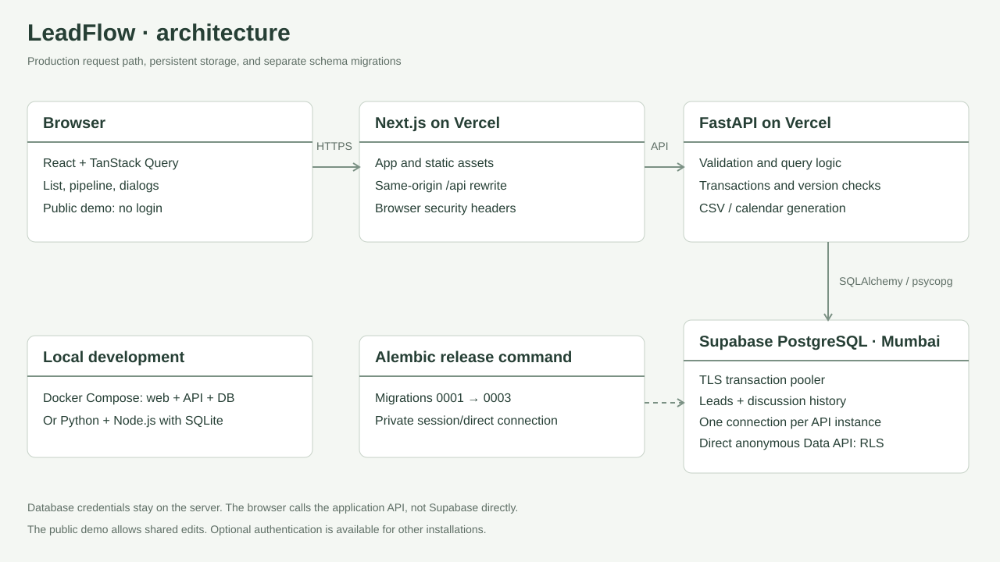
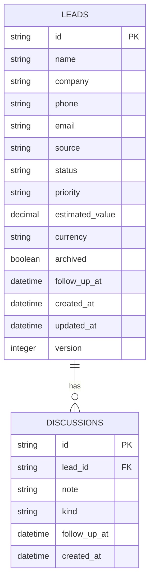
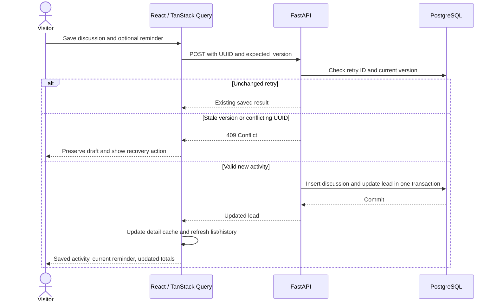
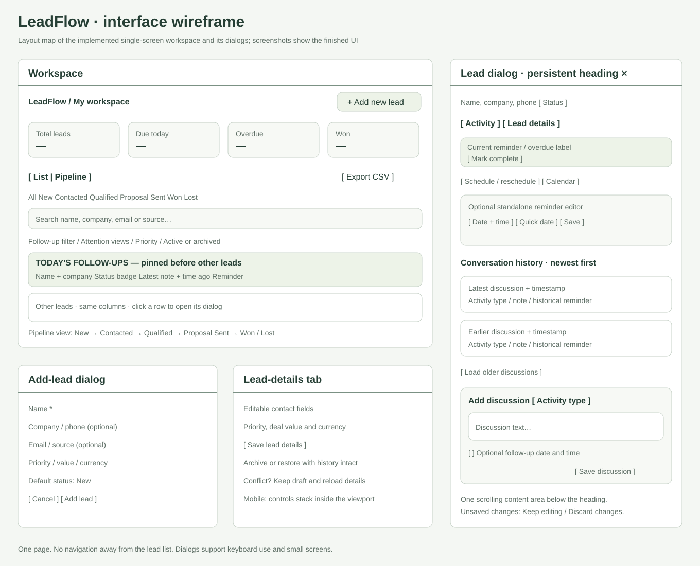

# Architecture and design

LeadFlow is one shared workspace with a Next.js/React frontend, a FastAPI REST API, and persistent SQL storage. The public demo intentionally opens without login. The optional password gate is retained for installations that configure it; it is not enabled on the live demo.

## Deployment boundaries

| Layer | Responsibility | Hosted / local deployment |
| --- | --- | --- |
| Browser | React components, TanStack Query server state, form drafts, timezone display, accessible Radix dialogs | Same single-screen UI on desktop and mobile |
| Next.js | Serve the app and assets; rewrite `/api/*` to `API_INTERNAL_URL`; supply browser security headers | Vercel `leadflow-crm`; local standalone Node.js or development server |
| FastAPI | Validate input, enforce origin/client-header checks, run lead/history/filter/export operations, optional authentication, safe errors | Vercel `leadflow-api`; local Uvicorn container/process |
| SQLAlchemy / psycopg | SQL queries, transactions, UTC conversion, bounded connection pooling | Supabase transaction pooler in production; Docker PostgreSQL or local SQLite |
| Alembic | Apply versioned schema changes before the app release | Separate administrative command; not run on each serverless invocation |
| Database | Persist leads, discussions, optional-login throttle state, and migration version | Supabase PostgreSQL in Mumbai; local PostgreSQL volume or SQLite file |

The frontend receives no database connection string or service-role key. Browser requests use the app's same-origin `/api` route. The API connects to the Supabase pooler with TLS, one pooled connection per serverless instance, no overflow, and automatic prepared statements disabled. Migrations use a provider-supplied direct/session connection. These settings bound per-instance use; they are not a claim of unlimited aggregate capacity.

PostgreSQL row-level security is enabled on `leads`, `discussions`, `login_windows`, and `alembic_version`, with no anonymous read policies. The private backend database connection can access the tables. Because this is an intentionally public demo, the application API itself permits shared reads and writes without a login; RLS does not turn it into a private multi-user application.

## Data model

`leads.follow_up_at` is the current reminder. A discussion's optional `follow_up_at` records the reminder captured with that historical activity. Completing or rescheduling the current reminder does not rewrite history. `login_windows` stores the shared rate-limit window only when optional login is used. `alembic_version` records the schema revision.

Database constraints cover the six statuses, three priorities, four currencies, nonnegative deal values, and positive record versions. Composite indexes support status/reminder queries, archive/priority filtering, and stable history ordering. [Models](../backend/app/models.py) and [migrations](../backend/migrations/versions/) are the authoritative schema.

## Save and refresh flow

The list query applies today-first ordering before pagination. Discussion history uses creation time plus UUID as a deterministic tie-breaker. Counts and currency totals cover all matching records, not only the loaded page. Server input validation and version checks remain authoritative even when forms also validate input.

## Wireframe and component map

The wireframe documents the implemented layout, not an additional screen. The main page switches between list and pipeline views. Add-lead and lead-detail dialogs stay on that page. The lead dialog has one scrolling content area below its persistent heading. A nested confirmation protects unsaved note, profile, and reminder edits; **Keep editing** receives initial focus, Escape cancels the discard, and focus returns to the originating control.

| UI area | Source |
| --- | --- |
| Workspace, search, filters, list, counters | [workspace.tsx](../frontend/src/components/workspace.tsx) |
| Pipeline lanes, paging, stage selectors | [pipeline.tsx](../frontend/src/components/pipeline.tsx) |
| Lead creation and shared contact fields | [add-lead.tsx](../frontend/src/components/add-lead.tsx), [contact-fields.tsx](../frontend/src/components/contact-fields.tsx) |
| Activity history and discussion composer | [timeline.tsx](../frontend/src/components/timeline.tsx) |
| Profile edits and archive/restore | [edit-lead.tsx](../frontend/src/components/edit-lead.tsx) |
| Standalone follow-up scheduling and calendar download | [reminder-tools.tsx](../frontend/src/components/reminder-tools.tsx) |
| Shared dialogs, discard confirmation, errors, badges | [ui.tsx](../frontend/src/components/ui.tsx) |

## Reliability and scope

Automated checks cover both database engines, desktop/mobile browser flows, accessibility, conflicts, retries, timezone boundaries, migration integrity, seeds, and Docker startup. The [verification record](VERIFICATION.md) distinguishes those executed checks from untested load, browser, and availability claims.

This is not a multi-tenant CRM: individual accounts, ownership, mail/call delivery, calendar synchronization, automated outreach, and predictive scoring are outside the implemented scope. Follow-ups appear inside the app and can be exported as calendar files. The Supabase free plan's availability and backup limits are documented in the [deployment guide](DEPLOYMENT.md).
